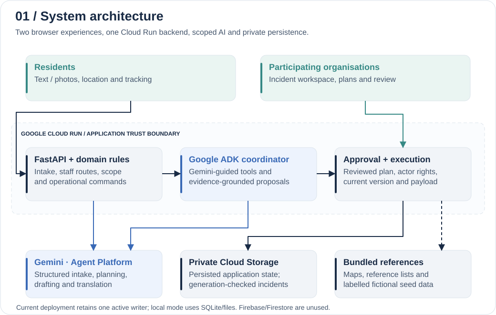
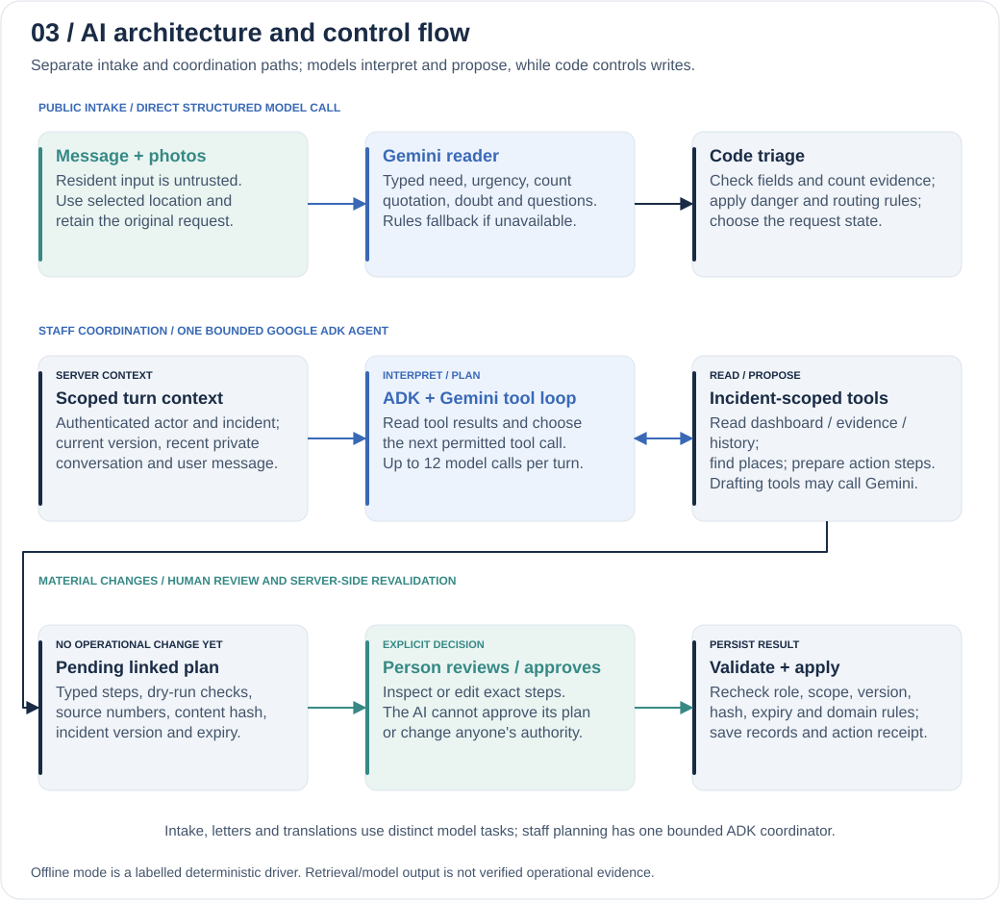
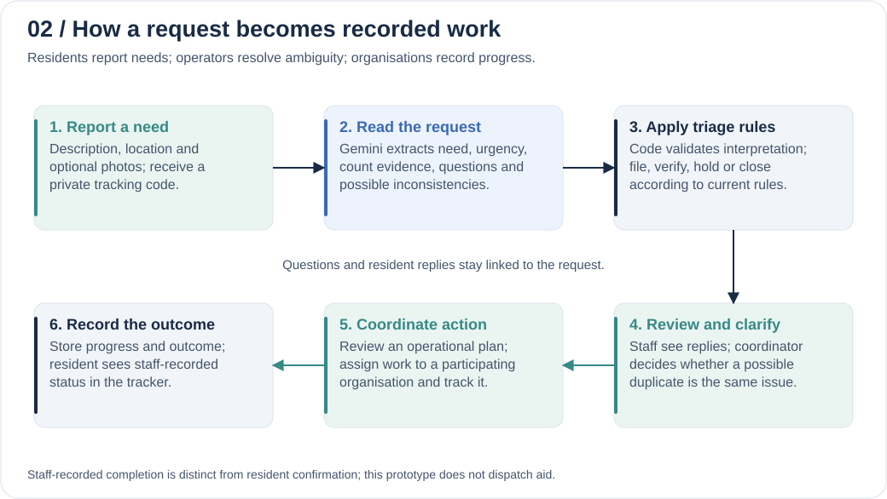

<p align="center">
  <picture>
    <source media="(prefers-reduced-motion: reduce)" srcset="docs/assets/lastmile-logo-static.png">
    
  </picture>
</p>

<h1 align="center">LastMile Response</h1>
<p align="center"><strong>From a resident's request to a coordinated response.</strong><br>Gemini + Google ADK · Google Cloud Run · Human-approved operational plans</p>
<p align="center"><strong>Team MOB</strong> · Lithira Aponsu &amp; Pulsara Aponsu<br>AI Builder Cup 2026 · Sustainability &amp; Social Impact</p>

**[Try the workspace](https://lastmile-alert-74y2iwqhzq-el.a.run.app/) · [Resident page](https://lastmile-alert-74y2iwqhzq-el.a.run.app/public) · [Architecture](docs/ARCHITECTURE.md) · [AI implementation](docs/AI_USAGE.md)**

Sri Lankan disaster-response teams need to connect scattered requests, reports and resources. LastMile gives residents a way to report needs and track staff updates, while organisations share evidence, clarify requests, assign work and record outcomes in one workspace. The intended benefit is fewer lost requests and clearer accountability; field impact has not yet been measured.

**Report → review → coordinate → track:** residents send text/photos and answer questions; staff work from public-request boards across incidents or inside one incident; the responsible body records progress. Notifications take reviewers to the relevant request. Possible duplicates need a human decision, and separate delivery sites retain their own quantities and completion.

> **Submission links:** 3–4 minute demonstration video and final template-based PDF will be added after verification. Editable PPTX is withheld for now.
<!-- Add verified PDF/video links here before submission. Add a PPTX link only after explicit release; no broken placeholder links. -->

## Where Gemini does the work

**AI is part of intake, planning and communication:** Gemini interprets public text/photos into structured needs, counts, urgency and clarification questions; the ADK coordinator retrieves incident evidence and prepares linked action plans; Gemini drafts letters and multilingual messages. Code controls routing, permissions, quantities and approval. Models cannot grant roles, approve their own plans or establish that aid was delivered. [Usage, source map and limits](docs/AI_USAGE.md).

**Google stack:** Gemini on Vertex AI, Google ADK, Cloud Run and private Cloud Storage. **Firebase and Firestore are not currently used.** Offline mode is explicitly labelled deterministic simulation.

## Architecture at a glance

[](docs/assets/system-architecture.svg)

Blue marks AI components; teal marks people/review; navy marks application rules. Open any diagram for full-size detail. [Storage, boundaries and source map](docs/ARCHITECTURE.md).

## Evidence against the judging criteria

| Official criterion | Implemented contribution | Inspect or try |
|---|---|---|
| **Technical Merit & Gen AI Implementation — 40%** | Structured Gemini intake; evidence tools through ADK; version-bound plans, server permissions and approval; deployed Cloud Run prototype. Current storage retains one-writer constraints. | [AI implementation](docs/AI_USAGE.md), [architecture](docs/ARCHITECTURE.md) |
| **Problem Alignment & Impact — 25%** | Resident reporting/tracking connected to organisation queues, clarification, assignments and resource records. | [Evaluation walkthrough](docs/JUDGE_GUIDE.md); impact remains a pilot hypothesis. |
| **Innovation & Creativity — 25%** | Linked, editable action plans connect source evidence, requests, communications and recorded outcomes across bodies. | Try the plan-to-action workflow; [design](docs/ARCHITECTURE.md). |
| **User Experience & Solution Design — 10%** | Phone-friendly public page, English/Sinhala/Tamil interfaces, maps, role-specific queues and notifications. | [Resident page](https://lastmile-alert-74y2iwqhzq-el.a.run.app/public); native-language review remains pending. |

Weights follow the [official rubric](https://aibuildercup.com/themes.html). This table maps implemented work, not an official score.

**Measured AI evidence:** saved, re-scored held-out text decisions: **Gemini 22/24 vs rules 19/24**. Both recorded zero false closures in that small set. Builder-authored synthetic cases; not photo, translation, coordinator-plan or field validation. [Evidence and limitations](docs/EVIDENCE.md).

## How the AI works

[](docs/assets/ai-architecture.svg)

The coordinator reads scoped evidence, proposes linked steps and returns a reviewable plan. Staff inspect/edit it; the server rechecks permissions, content, version and expiry before applying it. [AI tasks and tools](docs/AI_USAGE.md) · [Approval and recovery diagram](docs/assets/approval-and-recovery.svg).

## From a request to a recorded outcome

[](docs/assets/request-workflow.svg)

Possible duplicates require a coordinator's decision. Staff-recorded completion is distinct from resident confirmation. [Try the walkthrough](docs/JUDGE_GUIDE.md).

## Run a fictional local exercise

```sh
docker build -t lastmile-response .
docker run --rm -p 8080:8080 -e LASTMILE_LLM=fake -e LASTMILE_TEAM_DEMO=true -e LASTMILE_MAIL=off lastmile-response
```

Open `http://localhost:8080`. This mode uses no Gemini credentials and makes no model calls. [Judge walkthrough](docs/JUDGE_GUIDE.md).

**Prototype boundaries:** fictional operations; no real dispatch, payments or agency endorsement. Native-speaker/practitioner validation and distributed multiwriter deployment remain future work. Development used AI assistance under the team's direction. First-party permissions are in [LICENSE](LICENSE); upstream material retains its [own notices](THIRD_PARTY_NOTICES.md). This private candidate still needs the documented public-release rights checks; accepted [competition terms](https://docs.google.com/document/d/e/2PACX-1vRm7ChZ6Ij9fG7uFDkxzUMpwgVeBmnQ6cMDnAIEEX84AiLBOOQ9cYbl3S5OzFBbcVb8TF55s-eVpiXb/pub) remain applicable.
