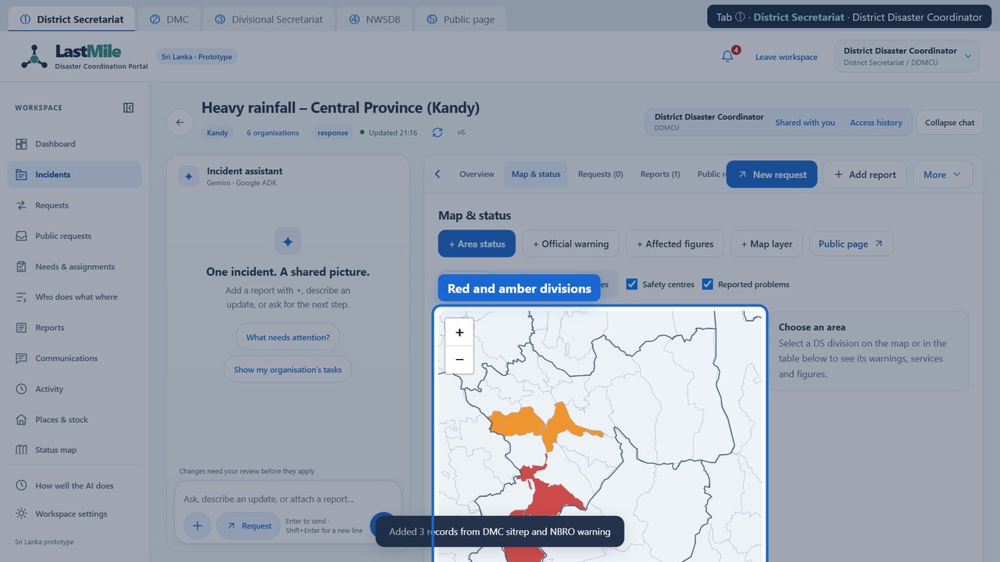
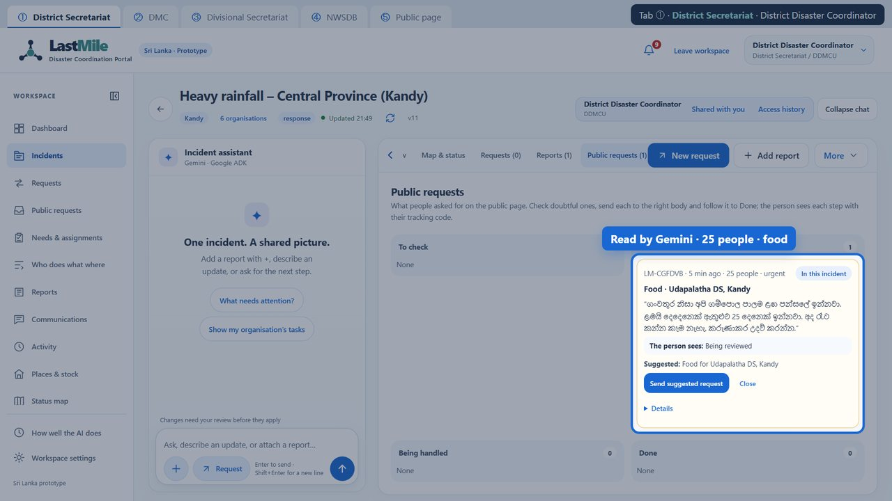
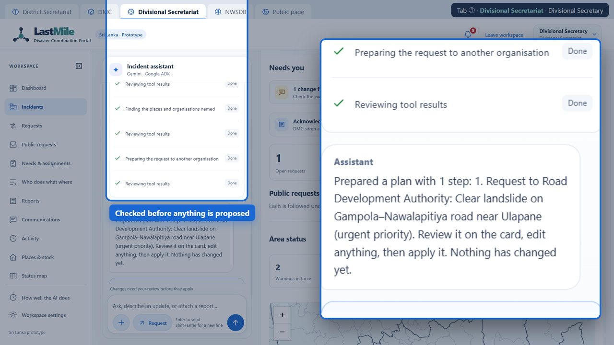
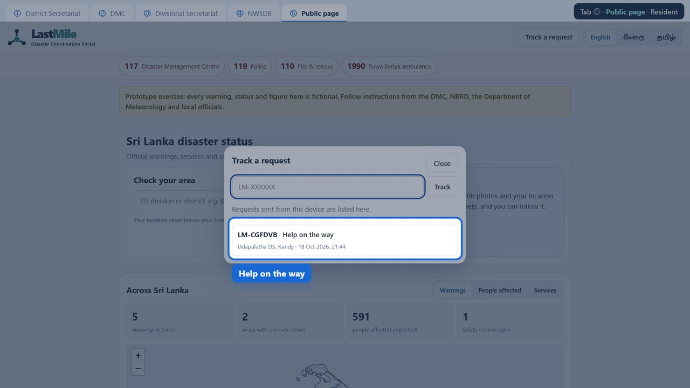
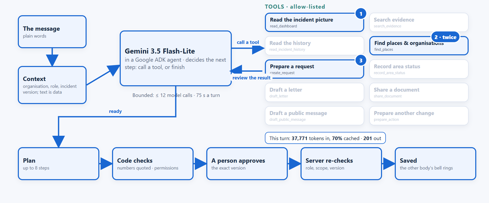
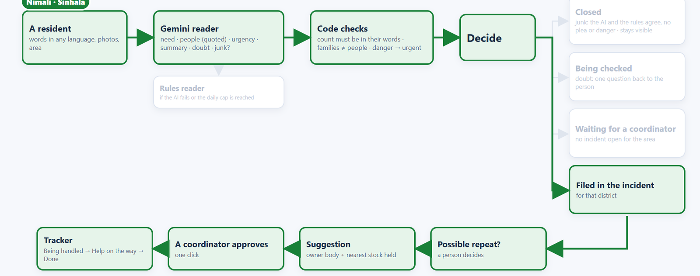
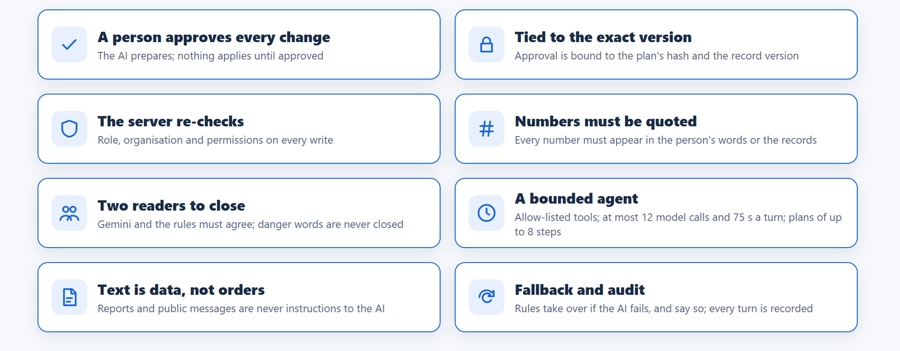
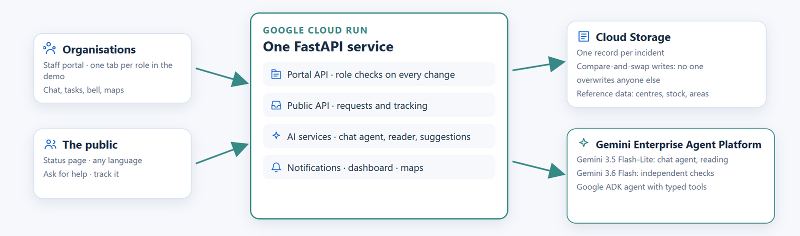

<p align="center">
  <picture>
    <source media="(prefers-reduced-motion: reduce)" srcset="docs/assets/lastmile-logo-static.png">
    
  </picture>
</p>

<h1 align="center">LastMile Response</h1>
<p align="center"><strong>From the first warning to the last mile.</strong><br>One live portal for every disaster agency, every request and every person, with Gemini doing the paperwork.</p>
<p align="center"><strong>Team MOB</strong> · Lithira Aponsu &amp; Pulsara Aponsu · AI Builder Cup 2026 · Sustainability &amp; Social Impact</p>

<p align="center">
  <a href="https://www.youtube.com/watch?v=t2vgS3u6gh8"><strong>▶ Watch the demo (3:23)</strong></a> ·
  <a href="https://lastmile-alert-74y2iwqhzq-el.a.run.app/"><strong>Try it live</strong></a> ·
  <a href="https://lastmile-alert-74y2iwqhzq-el.a.run.app/public">Public page</a> ·
  <a href="docs/LastMile-Response-presentation.pdf">Presentation (PDF)</a> ·
  <a href="docs/JUDGE_GUIDE.md">Judge guide</a>
</p>

## When the rain doesn't stop, every minute counts

When floods and landslides hit Sri Lanka's hills, every agency has to act at once. A family waits at a temple with no food; a shelter runs out of water; a road disappears. The help usually exists, but it is lost in phone calls, letters and messages between a dozen offices, and the people affected often hear last, with nowhere to ask.

**LastMile Response puts it all on one live portal.** Agencies work on one shared incident record. Residents see the status of their area and ask for help in Sinhala, Tamil or English. And instead of filling in forms, staff say what is needed in plain words: Gemini prepares the request, the letter or the update, and a person approves it.

| | |
|---|---|
|  |  |
| **One live picture.** A pasted situation report turns divisions red and amber for every agency at once. | **Anyone can ask.** Gemini reads a request in Sinhala (25 people, food, urgent) and prepares the request to the right body. |
|  |  |
| **Say what's needed.** A Google ADK agent works step by step with tools; every step is shown. | **And see help coming.** The resident's tracking code moves to "Help on the way". |

Screens from a recorded fictional exercise in the real app with real Gemini.

## What it does

- **Ask for help, any language.** Words, photos and area from the public page, with no login; a tracking code shows each step.
- **Public requests board.** Gemini reads need, people and urgency; code checks it; a possible repeat waits for a person; spam is set aside only when Gemini and the rules agree.
- **Say it in chat.** One sentence becomes an exact plan (a request to another body, a letter, a status update), applied only when a person approves.
- **Requests between agencies.** Accept, deliver, confirm, with priorities, due times and automatic escalation from the Divisional Secretariat to the district and the DMC.
- **Warnings and a live map.** Figures and NBRO-style warnings read from bulletins colour every DS division; services and shelters on the same map, and selected information published to the public page.
- **Warning texts in three languages.** English from a template; Sinhala and Tamil translated by Gemini with the level, places and hotline locked.
- **Notifications bell.** What is waiting for your organisation and role, since when, and what other bodies did; read each or all.
- **Shelters, stock and who does what where.** Shared stock holds, shelter capacity and a who-does-what-where matrix across incidents.

## How we use Google services

| Google service | What it does in LastMile |
|---|---|
| **Gemini 3.5 Flash-Lite** on the **Gemini Enterprise Agent Platform** (formerly Vertex AI) | Reads public requests into a checked structure (need, people quoted from the words, urgency, summary); drives the chat agent |
| **Gemini 3.6 Flash** | Translates warning texts into Sinhala and Tamil with the facts locked; independent checks |
| **Google ADK** | The chat agent: a bounded loop over ten typed, allow-listed tools that turns one sentence into an exact plan |
| **Cloud Run** (asia-south1) | Serves the FastAPI app and API; role, scope and version checks on every write |
| **Cloud Storage** | One record per incident, written with compare-and-swap; reference data and photos |
| **Cloud Build · Artifact Registry · Cloud Monitoring** | Container builds and images; token and request usage for cost tracking |

Firebase and Firestore are not used.

## AI architecture

**One chat turn, step by step.** The message arrives with its context: organisation, role and the incident's current version. Gemini, in a Google ADK agent, decides each step: call one of its ten allow-listed tools, or finish. Every tool result is reviewed before the next step. Below, the road request as it really ran: it read the incident picture, found the places and organisations named (twice) and prepared the request, using 37,771 tokens in (70% cached) and 201 out.

[](docs/assets/ai-chat-turn.png)

**A public request.** A Gemini reader returns a structured reading; code checks it; the decision is closed (junk only when Gemini and the rules agree), being checked (one question back), waiting for a coordinator, or filed in the incident with a suggested request. Green below: a resident's Sinhala request, all the way to "Help on the way".

[](docs/assets/public-request-flow.png)

**Guardrails.** The AI prepares; people decide; every step is recorded.

[](docs/assets/guardrails.png)

Limits are enforced in code: at most 12 model calls and 75 seconds per chat turn, 4,096 output tokens per call, and plans of at most 8 steps. More detail: [AI usage and source map](docs/AI_USAGE.md) · [approval and recovery](docs/assets/approval-and-recovery.svg).

## Application architecture

[](docs/assets/app-architecture.png)

[Storage, boundaries and source map](docs/ARCHITECTURE.md) · [Deployment](docs/DEPLOYMENT.md) · [Configuration](docs/CONFIGURATION.md)

## Evidence

| Held-out set, 24 public requests | Rules alone | Gemini |
|---|---|---|
| Right decision (file, hold, check, close) | 19/24 (79%) | **22/24 (92%)** |
| Right need · right owning body | 15/19 · 16/19 | **19/19 · 19/19** |
| Real requests wrongly closed (target 0) | 0 | **0** |
| Development set, 54 cases: right decision | 51/54 (94%) | **53/54 (98%)** |

Synthetic cases written by the team in English, Sinhala, Tamil and Singlish, also shown in the app under "How well the AI does". **621 automated tests** pass (API and browser), and an accessibility audit finds **0 violations on 55 screens**. Photos, practitioners and native-speaker review are not yet evaluated. [Evidence and limitations](docs/EVIDENCE.md) · [Testing](docs/TESTING.md).

## What it costs

| | Prototype today (measured) | National deployment (estimate, severe monsoon month) |
|---|---|---|
| Cloud Run | 1 vCPU · 512 MiB · scales to zero · free tier | 2 always-on instances → ≈ $192 |
| Gemini | whole build so far ≈ $2.69 | 50k public requests + 20k chat turns + 4k translations → ≈ $267 |
| Storage, images, builds | < $1 | < $2 |
| **Per month** | **≈ $3** | **≈ $460** (quiet month ≈ $220) |

About **$0.0006 per public request** and **$0.012 per AI chat turn**, from measured tokens at published list prices; Cloud Run priced at higher-tier rates as an upper bound. Excludes SMS gateway charges, a transactional database (roadmap), staff and taxes.

## How it maps to the judging criteria

| Criterion | What to look at |
|---|---|
| **Technical Merit & Gen AI Implementation (40%)** | Structured Gemini intake with code checks; Google ADK agent with ten typed tools; exact-version approval and server re-checks; measured benchmark; deployed on Cloud Run |
| **Problem Alignment & Impact (25%)** | Residents' requests reach the body that owns them and are tracked to the end; every agency shares one picture |
| **Innovation & Creativity (25%)** | One sentence becomes a checked, multi-step plan; one record links public requests, agency requests, warnings, stock and the resident's tracker |
| **User Experience & Solution Design (10%)** | Public page with no login in three languages, live maps, the notifications bell, role-specific queues; accessible by audit |

Weights follow the [official rubric](https://aibuildercup.com/themes.html); this maps implemented work, not a score.

## Try it

**Live:** open [the app](https://lastmile-alert-74y2iwqhzq-el.a.run.app/), choose an organisation and role, and open one browser tab per team; roles are simulated in this demo and can be switched from the top-right corner. Residents use [the public page](https://lastmile-alert-74y2iwqhzq-el.a.run.app/public). Step-by-step: [judge guide](docs/JUDGE_GUIDE.md).

**Locally, with no credentials and no model calls:**

```sh
docker build -t lastmile-response .
docker run --rm -p 8080:8080 -e LASTMILE_LLM=fake -e LASTMILE_TEAM_DEMO=true -e LASTMILE_MAIL=off lastmile-response
```

Open `http://localhost:8080`. The offline mode is a labelled deterministic simulation.

**Prototype boundaries:** fictional operations; no real dispatch, payments or agency endorsement. Native-speaker/practitioner validation and distributed multiwriter deployment remain future work. Development used AI assistance under the team's direction. This curated source is published for evaluation under the first-party permissions in [LICENSE](LICENSE); upstream material retains its [own notices and documented provenance limitations](THIRD_PARTY_NOTICES.md). Accepted [competition terms](https://docs.google.com/document/d/e/2PACX-1vRm7ChZ6Ij9fG7uFDkxzUMpwgVeBmnQ6cMDnAIEEX84AiLBOOQ9cYbl3S5OzFBbcVb8TF55s-eVpiXb/pub) remain applicable.
