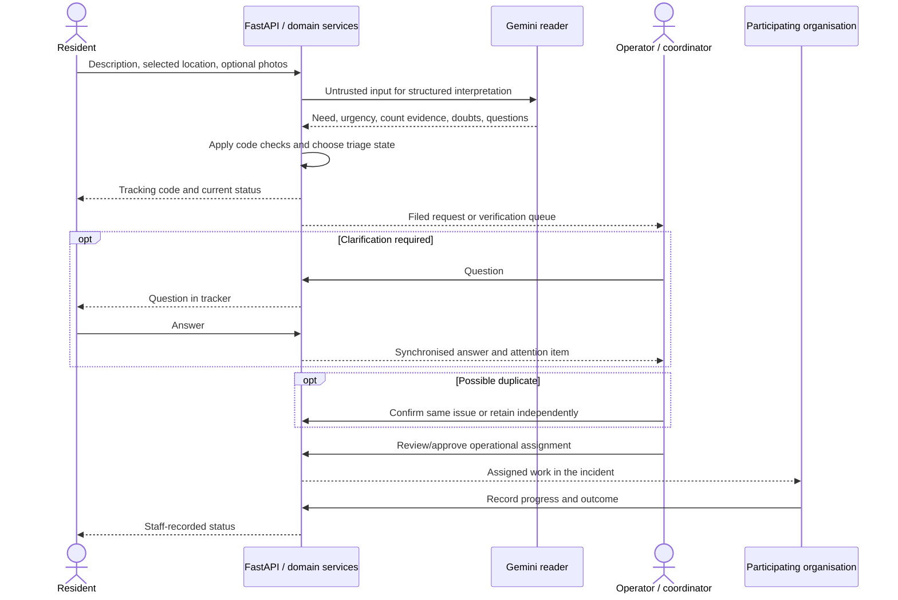
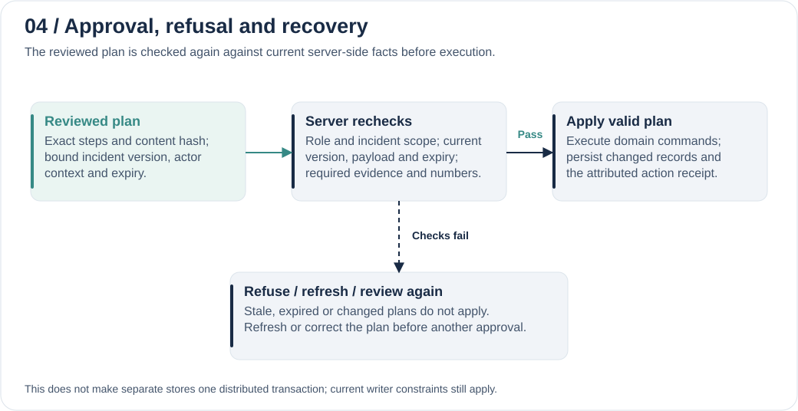

# Architecture: LastMile Response

These diagrams describe the supplied source candidate. Reconfirm source/deployment alignment before the final public submission; release and validation details are recorded in `release-manifest.json` and [EVIDENCE.md](EVIDENCE.md).

## System and deployment boundaries

Each diagram is a self-contained editable SVG with a title, description and readable text; click it for full-size inspection. PNG exports are supplied alongside the SVGs for presentation reuse. Blue denotes model/agent work, teal denotes people/review and navy denotes application rules.

Gemini is not the database or the authority for permissions. Public intake uses a structured model reader directly; conversational planning uses ADK. Letters/translations are separate model tasks. These paths are not a claim that every model call is an autonomous agent.

Cloud Run uses its attached Google identity for the Gemini Enterprise Agent Platform (formerly Vertex AI) and private storage. Credentials stay server-side. Cloud incident records use generation-checked writes; legacy caches and cross-incident shared resources still constrain the deployment to one active writer process/revision/instance. This is not a claim of distributed transactions or unrestricted horizontal scale. Local operation uses SQLite/files and a deterministic offline model driver. Firebase/Firestore are not implemented.

## Resident request to recorded outcome

Triage may file or hold a request automatically; that does not approve a coordinator plan or independently verify the resident's report. Similarity alone must not establish shared beneficiaries or completion. A recorded outcome is not automatically resident confirmation, dispatch receipt or proof of real-world delivery.

Detailed resident/operator message exchange

## AI interpretation, retrieval and planning

Public intake sends text/photos to the typed Gemini reader; application checks validate fields and people-count quotations before triage. An unavailable/capped reader uses rules. That fallback is not a second Gemini call and has its own quality limits.

Staff planning uses one ADK coordinator, with an execution budget of 12 model calls per turn. Context is rehydrated from the authenticated actor's incident and private recent conversation. Tools read dashboards, source passages and history, resolve places or prepare typed steps. Drafting tools can make separate Gemini calls for letters/translation; this is not an autonomous agent fleet. The ADK in-memory runner is a turn execution buffer, not the persistent operational store.

Prepared steps are dry-run validated and represented as a pending plan with an exact content hash, incident version, actor context, checks and expiry. The review card describes the proposed commands; the model cannot approve itself or silently grant authority. Saved conversation/tool metadata supports inspection without making model text authoritative evidence. [AI usage and source entry points](AI_USAGE.md).

## Approval and recovery

Approval revalidates against current roles, incident scope, version, content, expiry and domain rules. Refused/stale plans require correction or refresh and renewed review; they are not automatically approved on retry. Commands apply within the incident's transaction boundary. This does not make every cross-store or cross-incident operation a single distributed transaction.

## Implementation map

| Component | Source in the submission snapshot |
|---|---|
| API, public routes and staff permissions | `lastmile/api.py`, `lastmile/teams_api.py`, `lastmile/team_workspace.py` |
| Public interpretation, triage and tracking | `lastmile/public_requests.py` |
| ADK tool loop and incident tools | `lastmile/coordinator.py`, `lastmile/team_agent.py` |
| Linked plans and approval | `lastmile/team_plans.py` |
| Drafting and translation | `lastmile/team_drafting.py`, `lastmile/team_messages.py` |
| Persistence and resources | `lastmile/workspace.py`, `lastmile/cloud_storage.py`, `lastmile/team_shared.py` |
| Browser interface and maps | `web/`, `web/components/`, `web/data/` |

[AI usage](AI_USAGE.md) · [Judge walkthrough](JUDGE_GUIDE.md) · [Evidence](EVIDENCE.md) · [README](../README.md)
